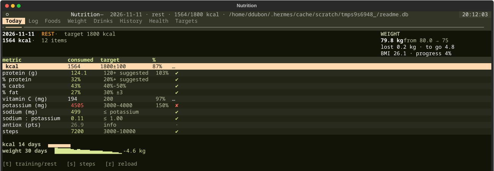

# Nutrition tracker (TUI)

Local-only terminal tracker for daily macros, minerals and body weight. Locally. 



## Install

Needs Python 3.10+ and a terminal. Linux only for now (the theme reads the
desktop's matugen palette and falls back to a dark one if it is not there).

```bash
git clone <this-repo> nutricion && cd nutricion
/usr/bin/python3 -m venv .venv
.venv/bin/pip install -r requirements.txt
.venv/bin/python -m nutri
```

Optional, to launch it from anywhere: copy `nutri` to `~/.local/bin` (the script
`cd`s into the checkout and uses its venv).

```
nutri                # normal use
nutri --tab pane3    # open straight on a tab (1 today … 8 targets)
nutri --db /tmp/x.db # use another database
```

Run from source without the launcher:

```
cd ~/Documents/Tracker-Nutricion
.venv/bin/python -m nutri
```

## Tabs

| # | Tab | What it does |
|---|-----|--------------|
| 1 | Today | the day at a glance: every metric vs its target, colour-coded |
| 2 | Log | add a food (search → grams → Add), delete a row |
| 3 | Foods | food database, 120 entries; add / edit / delete your own |
| 4 | Weight | log weight, 7-day average, trend |
| 5 | Drinks | weekly counter, one box per drink (coffee bar, teas, sodas, juices, smoothies) + sucralose |
| 6 | History | last 30 logged days, one row per day |
| 7 | Health | general goals (skin, swelling, antioxidants, muscle, weight) — trend only, nothing to tick |
| 8 | Targets | every number the app checks, body composition, weekly and monthly rollups |

## Keys

`1`…`8` switch tabs · `t` training/rest day · `s` steps · `r` reload (also re-reads
the desktop palette) · `q` quit · `n` / `e` / `d` new / edit / delete food in the
Foods tab · `d` delete the selected row in the Log tab.

Single-letter keys are ignored while you are typing in a field, so digits inside
the grams box never jump tabs.

In the **Log** tab the arrows drive the whole flow: `↓` in the search box jumps
into the food list, `↑` jumps into the log table, `↑`/`↓` scroll the log (the
cursor drags the view with it), `Home`/`End` go to the first/last row, `Esc`
takes you back to the search box and `d` deletes the selected row.

## Colour rules

- **green** — target met.
- **white** — in progress (today) or no data.
- **red** — target failed: over the limit, or a past day that missed it.

Calories: 2100 on training days, 1800 on rest days, ±100 counts as met.
Protein 120 g suggested (no ceiling — going over is never a failure) ·
carbs 40-50% · fat 30% fixed · vitamin C 200 mg ·
potassium 3000-4000 mg · sodium never above potassium (ratio ≤ 1) ·
steps 3000-10000 · sucralose ≤ 10 g/day · sugar-soda ≤ 10% of the week's drinks.

## Portion sizes

Picking a food fills the grams box with an average portion, and the selector next
to it offers the other sizes:

- produce and fruit get real weights per item — tomato 90/130/180 g, potato
  120/170/250 g, banana 100/120/150 g, one egg 50 g, a slice of bread 35 g;
- meat and fish get 100 / 200 / 400 g;
- grains 50/100/200 g dry, nuts 15/30/60 g, oil 1 tsp/1 tbsp/2 tbsp,
  spices pinch/1 tsp/1 tbsp, drinks 200/350/500 ml.

`custom` lets you type any weight. These live in `nutri/portions.py` — a layer of
its own, the food database is untouched, so a new food you add picks up its
group's defaults automatically.

## Body composition

Targets → Body holds height, starting weight, goal weight and **expected muscle
mass**. From those plus your latest weigh-in the app derives:

- **BMI** — plain weight / height², and what it would be at the goal weight;
- **FFMI** (fat-free mass index) and **normalised FFMI** — the version that does
  not punish you for being tall, with the usual reference bands
  (average 18-20, above average 20-22, excellent 22-24, elite > 25);
- lean mass, fat mass and fat %.

Lean mass is estimated as `muscle / 0.52` — skeletal muscle is roughly half of
fat-free mass — so set the muscle figure to a real measurement (a scale with
bioimpedance or a DEXA) and the rest follows. Without it you still get BMI.

## Weekly and monthly numbers

- **This week** (Targets) is computed live: days logged, workouts and the average
  kcal / protein / carbs / fat / vitamin C / potassium / sodium / weight.
- **Stored weeks** are frozen automatically once a week closes, so the history
  survives even if you edit a past day later. One row per week: days, kcal,
  protein, weight, workouts.
- **Monthly weight** is the mean ± sample standard deviation per calendar month,
  with the weigh-in count, min, max and the mean ± 1 SD range — the honest way to
  read a trend when day-to-day noise is a kilo either way.

## Drinks

The Drinks tab is a menu with a counter, not a logger: one row per drink, type
the number you had this week, pick the week at the top, save. Groups: coffee
(espresso, americano, drip, latte, iced latte, cappuccino, macchiato, flat white,
mocha, cortado, cold brew, frappé), teas, water, sodas (sugar / non-sugar /
energy), juices, smoothies and hot chocolate. Sucralose sits on its own box —
grams for the week, shown as a daily average.

Only **sugar-soda** counts against the 10% rule; non-sugar soda is tracked
separately. The recent-weeks table keeps the last eight weeks with their share
and status.

## Adding a food

Foods tab → `n`. Values are **per 100 g** (drinks per 100 ml). Only whole
ingredients: the app multiplies by the grams you log. `antiox` is a 0-3
practical scale, not a lab figure.

## Where the data lives

```
~/.local/share/nutricion/nutricion.db
```

Back it up by copying that file. Delete it to start over (the 109 catalogue
foods are re-seeded automatically).

## Theme

The interface reads the live matugen palette at
`~/.cache/quickshell/matugen.json` — the same one kitty and the rest of the
desktop use — so it re-colours itself when you change theme. Press `r` after a
theme change.

## Tests

```
.venv/bin/python tests/run_tests.py
```

Covers the maths (totals, traffic lights, weight progress), the database and a
headless boot of the UI with simulated key presses.

## License

MIT — see `LICENSE`.

## Layout

```
nutri/core.py    pure logic: targets, totals, traffic lights, stats, body composition
nutri/db.py      SQLite schema, migrations, queries
nutri/foods.py   the 120-food catalogue (USDA values per 100 g)
nutri/portions.py average portion weights per food / per group
nutri/drinks.py  the drink menu for the weekly counter
nutri/theme.py   matugen palette → Textual theme
nutri/app.py     the Textual UI
tests/           real tests (logic + db + headless TUI)
```
